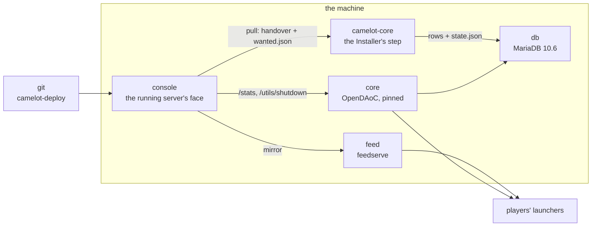

# Deploy

The server side of Camelot Forge, as containers. Five services, one entry point
(`compose.yaml`) and one environment file (`.env`). This file is the desk's
bench: host paths, a checkout beside it. A server install is `install/`: named
volumes, one bootstrap job, and `install.sh`.



| Service | Its own README | What it writes |
|---|---|---|
| `db` | — | its own volume, on loopback only |
| `core` | — | the database, `/app/logs`, and `/app/camelot` (the Installer plugin at boot on the server install) |
| `camelot-core` | `server/README.md` | `<env>/server/camelot/` (state, releases, applied) |
| `feed` | `feed/README.md` | nothing: it serves a directory read-only |
| `console` | `console/README.md` | `<env>/server/camelot/`, the audit, the feed mirror |

`notes/remote.md` §D10 says what runs where; `docs/admin.md` is the runbook
around it. `docs/install.md` walks the whole install, desk and server.

## A server

`install/` is the server's own entry point. One compose file, named volumes, and
a `camelot-bootstrap` job that clones the baseline and the deploy branch, writes
`machine.json`, provisions the database once, and seeds the feed.

```sh
cd install
./install.sh          # writes .env, generates the passwords, and exits
$EDITOR .env          # the five FILL values
./install.sh
```

`install/README.md` walks the deploy key, the release key, Coolify, the ports and
the first release. The stack below is the same services with host paths, for a
desk or a machine whose directories you manage yourself.

The server install bakes the C# Installer into `core`
(`deploy/core/Dockerfile`): the admin flow is **Pull → Restart**, and the plugin
applies the handed-over release before the world loads. `docs/coolify.md` is the
Coolify-specific production walk.

## Local

A desk that wants the whole thing in containers, including its own test server:

```sh
cp .env.example .env
$EDITOR .env
```

For a local run the four paths point at the desk's own folders, and the two
public values are loopback:

```dotenv
CAMELOT_SERVER_ENV=/home/you/daoc/forge-env-local
CAMELOT_DEPLOY_CHECKOUT=/home/you/daoc/forge-project
CAMELOT_BASELINE_SOURCE=/home/you/daoc/OpenDAoC-Database/opendaoc-db-core
CAMELOT_FEED_SOURCE=/home/you/daoc/forge-project/feed
CAMELOT_FEED_URL=http://127.0.0.1:8080/
CAMELOT_GAME_SERVER=127.0.0.1:10300
```

Then the first run, in this order:

```sh
docker compose up -d db
server/camelot.sh provision        # the baseline, then every handed-over release
docker compose up -d               # db, core, feed, console
server/camelot.sh api '<password>'  # atlas_api + api_password
server/camelot.sh restart          # the API host starts at boot
curl http://127.0.0.1:8080/healthz
```

The Console is on `http://127.0.0.1:8770/`, authenticated as `operator`.

## Online

The same commands with the real values — a public feed URL behind TLS, the game's
public address, and real secrets:

```dotenv
CAMELOT_FEED_URL=https://patch.example/
CAMELOT_GAME_SERVER=play.example:10300
CAMELOT_CONSOLE_PASSWORD=<a real secret>
CAMELOT_API_PASSWORD=<the server's api_password>
```

`CAMELOT_FEED_URL` and `CAMELOT_GAME_SERVER` are what the feed service writes into
`patchlist-new.txt` and `launcher.json` on every request: the feed published from
the desk keeps its local URL and works online unchanged (`F §D3`).

Ports to expose: the game's TCP and UDP (`10300`, `10400`) and the feed behind a
TLS reverse proxy. The Console and the database stay on loopback.

## An update

```text
desk     project release N → project feed → project publish N --remote origin
console  Pull          (fetch, verify sha256, hand over, mark wanted, mirror the feed)
server   the plugin at boot (Pull → Restart), or camelot.sh apply on the bench
players  their launchers read the feed and update themselves
```

The Console asks (`wanted.json`); the Installer writes (`S §D1`).

A bad apply is repaired on the server with `server/camelot.sh reverse`, or from
the Console's **Reverse** button, which asks and lets the Installer's next run do
the work: the rows the release changed go back, and the release leaves the folder
and the state. The feed keeps its order, so anything the players have already
seen is undone by a **new** release (`S §D17`).

## When something is off

```sh
docker compose ps                       # what is up, and what is unhealthy
docker compose logs -f core             # the game server's own output
docker compose logs -f console          # the Console's
curl -s http://127.0.0.1:8080/healthz   # the feed's version and where the game is
server/camelot.sh status                # what the environment holds
server/camelot.sh verify                # the database and the folder, read back
server/camelot.sh reverse               # put back the newest applied release (a repair)
```

The Console's page names what it could not read: a game port that does not
answer, an API that is off, a reload the server has no record of.
`docs/admin.md` §10 lists the refusals and what each one means.
