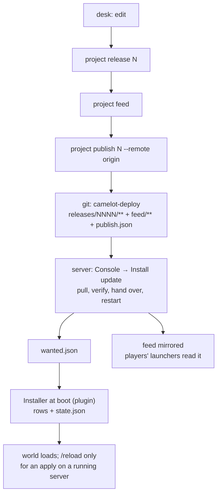

# Running a shard

This is the operator's runbook: what runs on which machine, what the daily flow
is, and what each refusal means. It is written for the person who runs **one**
OpenDAoC server and its client — the admin of a shard — and not for a
contributor (that is `AGENTS.md`, `docs/formats.md`, `docs/status.md`).

`docs/install.md` is the way in. This document is what you keep open once it is
done.

The worked example is a walk of 2026-10-18: a keep moved in
the world editor, released, published, pulled on a second server, and installed
by a player's launcher. Every path and number below is from that walk.

## 1. Two machines, five surfaces

| Surface | Runs on | What it does |
|---|---|---|
| **Studio** | the desk | the world editor and the asset library (`camelot studio …`) |
| **Deploy** | the desk | cuts releases and hands them to an environment (`camelot project release`, `project deploy`, `project promote`) |
| **Feed** | built on the desk, served on the server | what the players' launcher reads (`camelot project feed`, then `feedserve`) |
| **Console** | the server | the running server's face: what is applied, who is connected, **Install update** (`camelot console`) |
| **Installer** | the server | the only writer of the server's own rows (the C# plugin at boot on the server install; `camelot env apply` otherwise) |

The **players' launcher** is a package you hand out (§7).

What travels between the two machines is a git branch (`camelot-deploy`, §6) and
the players' HTTP traffic.

## 2. The desk

### The project folder

One folder holds the whole content of one shard:

```text
camelot-hills/
├── project.json          the shard's identity: its name, its base build, its environments
├── machine.json          this machine's own answers
├── journal/              the edit history — the source of every release
├── releases/NNNN/        release.json + server/ + client/ (the payloads)
├── feed/                 what the players' launcher reads
└── deploy/log.jsonl      one line per release, deploy, apply, reload, publish
```

Git carries `project.json`, `journal/` and `deploy/log.jsonl`. A teammate clones
the project and writes their own `machine.json`. The three derived folders are
rebuilt: a release comes back from the journal plus the base client, which is
what `camelot project verify --rebuild N` asserts.

### `machine.json`

This is the only file that stays out of git. Write it with the tool —
`camelot project machine` fills an environment from its `serverconfig.xml` — or
by hand if you prefer; `camelot project check` reads it back either way.

```json
{
  "author": "you",
  "client": "/home/you/daoc/clean-client",
  "environments": {
    "local": {
      "root": "/home/you/daoc/env-local",
      "database": "camelot_hills_local",
      "baseline": "/home/you/daoc/OpenDAoC-Database/opendaoc-db-core",
      "db": { "host": "127.0.0.1", "port": 3307, "user": "root" },
      "db_config": "/home/you/daoc/env-local/server/config/serverconfig.xml"
    },
    "staging": {
      "root": "/home/you/daoc/env-staging",
      "database": "camelot_hills_staging",
      "baseline": "/home/you/daoc/OpenDAoC-Database/opendaoc-db-core",
      "db": { "host": "127.0.0.1", "port": 3307, "user": "root" }
    }
  }
}
```

- `client` is the **pristine** client (§2, "the one rule"), and it is what
  `project release`, `project feed` and `project publish` read.
- `environments.<name>.root` is where that environment lives on this machine.
- `baseline` is OpenDAoC's own database checkout; `env provision` imports it.
- `db` is how `env` reaches the environment's MySQL. Without it, `env` falls back
  to the authoring server's `serverconfig.xml`, then to `$CAMELOT_DB_HOST`,
  `_PORT`, `_USER`, `_PASSWORD`. The **viewer** does not read `db`: it reads the
  environment's `db_config`, and that file carries the port and the database.
- `"client": false` in an environment's block declares it **server-only**: no
  client half, no client folder. That is what a VPS is (§8).

Write the file with the tool, not by hand:

```sh
camelot project machine --dir ~/daoc/camelot-hills \
  --client ~/daoc/clean-client \
  --db-config ~/daoc/env-local/server/config/serverconfig.xml \
  --release-key ~/daoc/keys/camelot-release
camelot project check --dir ~/daoc/camelot-hills
```

`project machine` derives the environment's folder, database, host and port from
the `serverconfig.xml`. `project check` reads the file back and refuses what the
tool cannot reconcile: a config that opens **another** database than the one
`machine.json` names, a client that is not there, a database that does not
answer, an environment the project does not declare. The project's verbs
(`release`, `publish`, `env`, `studio`) refuse to run when the file is
missing.

A daemon started with no client (`camelot serve`) serves **Home** only. The
**New project** modal names the client, and the daemon adopts it when the project
opens; `$DAOC_CLIENT` stays the last resort for the CLI's client-only verbs.

### The one rule: the client is pristine

`camelot project feed` and `project publish` stage a hardlinked copy of the
client you name and apply **every** release's client half to it, through the
same code that installs a pack. The files copied into `feed/` are the ones that
differ *from the client it was given*.

Give it the **pristine base** — the client as a player receives it, before any
mod — and `feed/` is a complete snapshot: any player on that base downloads
exactly what changed. Give it a working client and the feed holds only the
newest release's files, and it stays correct only because the directory
accumulates. Keep one clean copy (`/home/you/daoc/clean-client`) and edit
nothing in it. A working client as the source gives a feed that is quietly wrong.

### The environments

`project.json` declares their names (`local`, `staging`, `production` by
convention — staging optional); `machine.json` says where each one is on this
machine. `camelot project envs` prints the list and what each holds.

A desk usually has one **local** environment: its own folder, its own database,
its own ports, its own game server, built and patched from this machine.

## 3. The server

An environment's folder is the server's own folder, plus one directory that is
ours:

```text
/srv/forge/env/
├── server/               the game server's files (binary, config/, lib/, logs/)
│   └── camelot/          OURS — the Installer's folder, and the only thing we write
│       ├── state.json            what each release wrote, and the values it replaced
│       ├── releases/NNNN/        what Deploy (or the Console's Install update) handed over
│       ├── applied/NNNN/applied.json    one line per row: written / skipped / removed
│       ├── reversed/NNNN/reversed.json  the same, for a reversal
│       ├── wanted.json           the Console's ask: "apply release N"
│       ├── reverse.json          the Console's ask: "put release N back"
│       └── console/audit.jsonl   one line per Console action, refused or not
└── client/               only on a desk; a server-only environment has none
```

`state.json` is the single truth every other surface reads.

### Who writes the rows

Two ways to run the Installer on a server; the folder, the documents and the
Console's calls are the same either way.

- **the C# plugin** (`server-bridge/camelot-installer/`): the server install
  bakes it into the `core` image (`deploy/core/Dockerfile`), so the server
  compiles and runs it at every boot. It applies the handed-over release before
  the world loads, and records a failure instead of throwing it out of `Start()`;
- **the `camelot-core` job** (`deploy/server/`): the desk's own `camelot env
  apply`, in a container. It provisions and verifies too, which is why the
  bootstrap uses it; it is also the fallback for an apply without a restart.

On a non-container server the plugin is a manual step, once: the server compiles
its scripts *before* any hook runs, so a release cannot carry it.

```sh
mkdir -p /srv/forge/env/server/scripts/camelot-installer
cp server-bridge/camelot-installer/*.cs /srv/forge/env/server/scripts/camelot-installer/
# and add Newtonsoft.Json to <ScriptAssemblies> in config/serverconfig.xml
docker compose restart core          # or systemctl restart camelot-server
```

It reads `<server>/camelot/` by default; the server property
`installer_directory` moves it. The server install mounts that folder at
`/app/camelot` in `core` and sets `SCRIPT_ASSEMBLIES: Newtonsoft.Json`.

Around that folder, a server also has:

- a **deploy checkout**: a clone of the project repository, on the
  `camelot-deploy` branch, read-only from the server's side;
- a **feed directory**: what the feed service serves (`feedserve`, container or
  process);
- a **database**: MariaDB, the environment's own;
- the **Console**: one process, one page, one password.

## 4. The daily flow, worked

The example is real: a keep moved in the editor, one release, one publish, one
click on the server, one player's launcher updating itself.

### 4.1 Edit, on the desk

```sh
camelot studio ~/daoc/camelot-hills --edit
```

With no path, `studio` opens this folder if it is a project, then the newest
project in the machine's list, then Home (where one is created). It reads
`machine.json` (the client, the environment's `db_config`), checks them, starts
the daemon and opens `/world`. `--edit` adds the permission to write the server's
rows; without it the page is read-only. The environment's database must be
running for the mobs to appear: `camelot project check` says whether it is. The
game server is not needed to edit — only to play and to `env deploy`.

Open `/world`, select the keep, move it. Every edit is journaled immediately;
nothing touches the database or a client until you test or publish. **Test
locally** (in the World bar, or on Deploy) cuts the edits into a release and
installs it on this machine's `local` environment; **Publish** then sends that
same release to the server.

The Navigator lists the zone's NPCs, statics and doors by name, guild, id and
model; click one to select it, double-click to frame it. Nearby NPCs are drawn
with their client figures and names; statics and doors are wireframe volumes.
The **Models** and **Labels** toggles turn that layer off, and **reload models**
re-reads the figures after a client import.

### 4.2 Publish

Deploy → **Publish**. One click does what used to be three verbs:

1. cuts the next release when the journal holds edits;
2. builds the players' feed from it;
3. signs the release record with this machine's `release_key`, commits
   `releases/NNNN/**`, `feed/**` and `publish.json` to `camelot-deploy`, and
   pushes `origin`.

The card says what is waiting (`2 objects edited · 3 database rows`) and, once
cut, the release number. **Test locally** is the same cut plus a deploy and an
apply to `local`; **See details** is a read-only dry run of what installing the
newest release here would change.

The CLI equivalent, for a desk without a browser:

```sh
camelot project publish --dir ~/daoc/camelot-hills --remote origin
```

It commits the payloads, the feed and a `publish.json` marker to
`camelot-deploy` with git's plumbing, so your working branch and its index stay
as they are. The content branch is where you version your work;
`camelot-deploy` is the transport. The deploy log gains one `publish` line;
the publish deliberately leaves your branch alone, so the settings fold offers
**Save the deploy history** when that line is not committed yet.

Without a `release_key` the release is published **unsigned**, and a server
that checks signatures refuses it.

### 4.3 Install on the server

Console → **Install update**. One click: it pulls (fetch, verify the signature
and the sha256s, hand the server half over, write `wanted.json`, mirror the
feed), restarts the game server, then waits for the Installer's own state to
record the release. The page shows the three steps and refreshes itself;
**Players** shows who is connected by name.

On the server install the C# Installer runs at boot: the plugin reads
`wanted.json` and `releases/NNNN/` before the world loads, writes the rows, and
records `state.json` and `applied/NNNN/applied.json`. The Console then says
"Up to date".

The `camelot-core` job is the same step without a restart, and the fallback for
a server without the plugin:

```sh
camelot env apply production --dir /srv/forge/deploy
```

The Installer writes the release's rows into the environment's database, records
what it wrote and the values they had before in `state.json`, and writes one line
per row in `applied/NNNN/applied.json`. All or nothing: a row that is not there
refuses the whole release and writes nothing.

**Pull** and **Restart** remain, separately, under **Update source** for a manual
sequence. The release's own ritual is unchanged: `/reload doors` in game for an
apply on a running server; an apply at boot needs no reload.

### 4.4 The players

They open their launcher. It reads the feed, compares it with what it installed,
and **updates the client by itself** when the shard publishes something newer;
Play opens when the update is done. If the feed is unreachable, an
already-installed client stays playable (with a line saying the shard could not
be checked); a first install needs the feed. Play is refused while the client is
behind a reachable feed.

## 5. A new local test server

```sh
# 1. the project, and the client it edits (recorded in machine.json)
camelot project new camelot-hills --dir ~/daoc --client "$DAOC_CLIENT" \
  --environments local,staging,production --git

# 2. the server's own files: an OpenDAoC build in <root>/server, its
#    serverconfig.xml already naming the database this environment will use

# 3. this machine's answers, derived from that config
camelot project machine --dir ~/daoc/camelot-hills \
  --client "$DAOC_CLIENT" \
  --db-config ~/daoc/env-local/server/config/serverconfig.xml
camelot project check --dir ~/daoc/camelot-hills --no-live

# 4. the environment's database, from OpenDAoC's baseline
camelot env provision local --dir ~/daoc/camelot-hills --yes
camelot env status local --dir ~/daoc/camelot-hills

# 5. author
camelot studio ~/daoc/camelot-hills --edit
```

`env provision` **drops and re-imports** the environment's database: it is what
makes a local server the baseline plus your releases. It refuses without `--yes`.

`env verify local` reads the whole thing back: the database's tables against the
baseline's, the releases the state records against the rows it holds, the files
in the folder. It is the check to run before you blame a release.

## 6. The remote channel



One release leaves by two channels, and they are different deliveries:

| | Server channel | Players channel |
|---|---|---|
| What travels | `releases/NNNN/server/` | the feed: the two protocol files and the changed client files |
| Where it lands | `<env>/server/camelot/releases/NNNN/` | the directory the feed service serves |
| Who writes | the Installer alone | the publish build, then served as files |
| When it takes effect | the next boot (plugin), or apply then `/reload` / restart (fallback) | whenever each player's launcher reads it |

The feed is built on the desk, because a zone archive is rebuilt from the **base
client** plus the changed entry and a server holds no client. The built files
travel to the server.

The one action the server can be told remotely is a **shutdown** (the Console's
Restart, which needs a supervisor to bring the server back). `/reload`, messages
and kicks are in-game GM commands; there is no console stdin.

### Who signed the release

The branch travels over a git remote and lands on a machine you may not own. The
hashes in `release.json` are recorded in the same commit as the files they
describe, so they catch a half-copied file and nothing more: whoever can write
the branch can rewrite both.

A signature is what a server can check without trusting the branch. One key, on
the desk:

```sh
ssh-keygen -t ed25519 -C camelot-release -f ~/daoc/keys/camelot-release
# and in machine.json:  "release_key": "/home/you/daoc/keys/camelot-release"
```

`camelot project publish` then signs the release **record** — which carries the
sha256 of every artifact, so one signature covers the whole release — and adds
the signature to the commit beside it.

On the server, copy the `.pub` and name it:

```sh
scp ~/daoc/keys/camelot-release.pub server:/srv/forge/keys/
# Console:   --release-key /keys/camelot-release.pub   (or CAMELOT_CONSOLE_RELEASE_KEY)
# the job:   CAMELOT_RELEASE_KEY=/keys/camelot-release.pub
```

The server install takes the same key as `CAMELOT_RELEASE_PUBLIC_KEY` and writes
it to `/keys/release.pub`.

A pull then checks the signature **before** it believes the hashes, and refuses
with the reason named:

```text
error: release 0001: the signature does not check out against
/srv/forge/keys/camelot-release.pub (Signature verification failed: incorrect
signature) — refusing to hand it over
```

**A server with no key still hands the release over**, and says so:
`signed not checked — no release key is configured`, and the Console's page
carries the same line. Until you set one, the deploy key's scope is the whole
trust boundary.

### Going back

There is no rollback verb: the launcher's protocol only moves forward, so a step
back **for the players** is a new release.

```sh
# on the desk: revert the change as a new operation, then
camelot project release          # → N+1
camelot project publish --remote origin
# on the server: Console → Install update (pull, restart, apply)
```

The clients converge on N+1 like any other update, and nobody rewrites the
`camelot-deploy` branch. The values a release replaced are in `state.json`, and
that is the evidence a reversal is written against.

**On the server, `env reverse` is the repair.** It
puts back the rows one release changed (a column to the value it had, a removed
row re-inserted whole, in one transaction), takes the release out of the state
and out of the environment's folder, and drops it from the Console's ask:

```sh
deploy/server/camelot.sh reverse            # the newest applied release
camelot env reverse production --release 6  # or name one
```

From the Console, the same thing without SSH: the page's **Reverse** button
writes the ask (`<env>/server/camelot/reverse.json`), and the Installer's next
run — the plugin at the next boot, or `camelot env apply` — does the work. The
Console writes asks; the database belongs to the Installer alone. The page shows
the ask as *asked* until the state stops recording the release, and
`camelot env apply` honours it before it applies anything else.

It is refused while a **later** release is applied (its values would be written
over), and it repairs the server only: a client whose launcher already took
release N's half keeps it, because the feed only moves forward. Use it in the
hours after a bad apply, for a row that should have been written differently or a
release withdrawn before the players took it. Anything the players have already
seen is undone by a new release (`server-install.md` §D17).

## 7. What a player receives

The package is built once per platform and per shard:

```sh
cd web/launcher && pnpm build && cd ../..
.venv/bin/python packaging/launcher/build.py \
  --name "Camelot Hills" --feed "https://patch.example/"
```

Output: `packaging/dist/camelot-launcher/` (the binary, `_internal/`, and
`shard.json`) plus a zip. `shard.json` carries the shard's name and its feed URL.
The game's address comes from the feed's `launcher.json`, and the feed service
writes both on the way out.

A shard that publishes launcher packages adds `--launcher https://patch.example/launcher/`
and bumps `--version` for every hand-out. The operator copies
`packaging/dist/camelot-launcher-<platform>.zip` and
`packaging/dist/launcher-manifest.json` to that URL. The page then offers
**Restart and update**: the launcher stages the package beside its own folder,
waits for the process to exit, renames the install to `.old-<version>`, moves
the staged folder in, starts the new process, and removes the old folder. A
failed move restores it.

On first open the page updates the **client** by itself when the feed publishes
a newer version; Play opens when that update is done. The launcher's own
**Restart and update** is separate: it appears only when the shard publishes a
new launcher package.

Hand out: the launcher package and the client. The client is the shard's own
business (the game is not redistributable). Every player has to start from the
**same base client** the desk fingerprints in `project.json`, because the feed
is a delta against it.

On Linux the game runs under Wine; on Windows `connect.exe` runs directly. The
launcher remembers the client folder and the account in
`~/.config/camelot-launcher/settings.json`; the password is never stored.

## 8. A VPS

The server install is `deploy/install/`: one compose file, named volumes, and a
`camelot-bootstrap` job. `install.sh` drives it on a bare VPS; Coolify deploys
the same compose file. `deploy/install/README.md` is the step-by-step; the
Coolify-specific walk is `docs/coolify.md`.

| Service | What it is |
|---|---|
| `db` | MariaDB, the environment's database, loopback only |
| `camelot-bootstrap` | the first run: deploy key, OpenDAoC baseline, `camelot-deploy` clone, `machine.json`, feed seed, database provision, `atlas_api`/`api_password` |
| `core` | OpenDAoC's **pinned digest** plus the C# Installer (`deploy/core/Dockerfile`); host network; API on `127.0.0.1:5000` |
| `feed` | `feedserve`: the feed directory, with the public URL and the game address rewritten per request; no host port, the proxy reaches it on the compose network |
| `console` | the Console, host-networked so it can reach the game's API on `127.0.0.1:5000` |
| `camelot-core` | the one-shot fallback: `env apply`, `env status`, `env verify` |

The bootstrap is idempotent and never drops a database that already has
`serverproperty`. It sets the two properties the Console needs, so the first
`core` boot has the API. The admin flow is **Install update** on the Console:
the plugin applies the handed-over release before the world loads.

The Console listens on loopback. Reach it through an SSH tunnel, or serve it to
the tailnet with `tailscale serve --bg 8770` and open
`https://<machine>.<tailnet>.ts.net/`; the bind stays `127.0.0.1:8770`.

The environment folder, the Installer's folder, the deploy checkout and the feed
are named volumes on the server install (`forge-env`, `forge-camelot`,
`forge-deploy`, `forge-feed`), so a VPS needs no prepared directory tree.

Two surfaces face the internet: the feed, through the proxy, and the game,
through the host's own ports. Coolify provides the first only; the second is a
firewall rule and a forward on the router or on the provider's side.

Five things to get right:

- the game's ports are the host's, not the proxy's. `core` publishes `10300/tcp`
  and `10400/tcp+udp` on the host's network; open them in the host's firewall,
  forward them in the NAT in front of it, and check the public address from
  outside the LAN (`nc -vz play.example:10300`);
- the API must bind `127.0.0.1:5000`. The OpenDAoC image's .NET default is
  `8080`, which another service may hold; the server install sets
  `ASPNETCORE_URLS=http://127.0.0.1:5000`. An environment change is a **redeploy**
  (the container is recreated), not a restart (the old environment stays);
- the feed has no `ports` mapping. Coolify's proxy reaches the container on the
  compose network; a host proxy needs an override with a `ports` mapping.
  Publishing `8080` on the host is what produces `port is already allocated`;
- `core` runs with `restart: unless-stopped`, so the Console's **Install update**
  and **Restart** bring the server back and the plugin applies the release;
- `camelot-bootstrap` and `camelot-core` are one-shot jobs. Both carry
  `restart: "no"`; without it a job that exited 0 is restarted in a loop.

### The server-only environment

On the desk, add the VPS to `machine.json` with `"client": false` and no client
path:

```json
"production": { "root": "/srv/forge/env", "client": false, "database": "camelot_hills_production" }
```

The dry run then names the release's client half as the feed's and hands over
only the server half, and `env verify` does not look for a client. The server's
own `machine.json` is generated by `camelot-bootstrap`; the desk's block is for
the dry run.

## 9. Backups

| What | Why | How |
|---|---|---|
| the project folder | it is the work: journal, releases, deploy log | git (the content branch) + your usual backup |
| the environment's database | accounts, characters, and the rows your releases wrote | `mysqldump` on a schedule; the release rows are reproducible, the players are not |
| `<env>/server/camelot/` | what is applied, and the values releases replaced | copy it with the database, or the two tell different stories |
| the feed directory | a player behind still needs what earlier publishes put there | the `camelot-deploy` branch has it; re-pull if it is lost |
| the deploy key | the server fetches with it | keep a copy in your password manager |

The database and `state.json` are one artefact: restore one without the other
and the next apply will either skip rows it should write or write rows that are
already there.

## 10. Refusals, and what they mean

| Message | What happened |
|---|---|
| `nothing to publish: the deploy branch already carries these bytes` | the feed and the payloads are already on the branch; nothing changed since the last publish |
| `no feed URL: pass --feed-url or set CAMELOT_FEED_URL` | a publish builds the feed, and the feed must say where it is served; a feed already built names one |
| `no release carries a client half yet` | `project feed` with no release: cut one first |
| `N file(s) the base has are not in the staged tree` | the protocol cannot remove a file from a player's client; a feed that lost a file is refused |
| `the checkout's bytes do not hash what the release record says` | the branch is not what the release recorded — do not hand it over; publish again |
| `the signature does not check out against <key>` | the record moved after it was signed, or the wrong key is configured; publish again, or point the server at the right `.pub` |
| `the branch carries no release.json.sig` | this server checks signatures and the publish was unsigned: set `release_key` on the desk and publish again |
| `the environment holds bytes this release does not record` | someone edited the server's files by hand; the pull refuses rather than overwrite |
| `camelot studio` says the machine is not ready | `machine.json` is missing or names something the tool cannot reconcile. `camelot project check` lists each field; `camelot project machine` writes the missing answers. |
| `an update is waiting — the client is at N, the shard publishes M` | the player's launcher refused Play until the client updates; it starts the update by itself when the page opens |
| `release 0006 cannot be reversed while release 0007 is applied` | the newer release's values would be written over: reverse the newest first |
| `release 0007 is not applied to this environment` | there is nothing to put back — the reversal needs the state the apply wrote |
| `the feed does not say where the game is` | the feed was served without `launcher.json` or without `CAMELOT_GAME_SERVER` |
| `[Errno 111] Connection refused` on `:5000` | OpenDAoC's API is off (`atlas_api`), failed to bind, or is on another port. The image's .NET default is 8080; the server install pins `ASPNETCORE_URLS=http://127.0.0.1:5000`. |
| `Failed to bind to address http://[::]:8080: address already in use` | the API is on the image's default port. Set `ASPNETCORE_URLS=http://127.0.0.1:5000` and **recreate** `core`; a restart keeps the old environment. |
| `installer directory 'camelot' does not exist; no release loaded` | `core` has no `forge-camelot` volume at `/app/camelot`; the plugin cannot see the releases. |
| `Bind for 0.0.0.0:8080 failed: port is already allocated` | a compose service publishes 8080 on the host. The server install's feed does not; the proxy reaches it on the compose network. |
| `Connection refused` on `play.example:10300` from outside the LAN | nothing forwards the game's ports. Coolify proxies 80/443 only; the host's firewall and the NAT in front of it must carry 10300/tcp and 10400/tcp+udp. |
| the client shows **press ESC** at the end of its loading | the client never reached the game. Check the feed's `launcher.json`, then the two game ports from outside the LAN. |
| `no MySQL on 127.0.0.1:3307 — the environment's database is not running` | the database behind the environment's `db_config` is down. Start it, then `camelot project check`. |
| `no release_key: a publish from this machine would be unsigned` | `camelot project machine --release-key <key>`, or set `$CAMELOT_RELEASE_KEY`. A server that checks signatures refuses an unsigned release. |
| `reload: unknown` on the Console | the server has no copy of the project's `deploy/log.jsonl`; that file is the desk's record |
| `this environment was provisioned for 'X', not 'Y'` | one environment folder, one project: `project.md` §D1 |
| `id N (zone Z, key K) is already held by <table> <key>` | a release allocates an id the server grew into; re-cut, the ids moved |

## 11. Where everything lives

| Path | What | In git |
|---|---|---|
| `project.json` | the shard's identity | yes |
| `machine.json` | this machine's paths, databases, keys | **no** |
| `journal/` | the edit history | yes |
| `releases/NNNN/release.json` | what the release is, and its digests | yes |
| `releases/NNNN/server/`, `client/` | the payloads | no (reproducible) |
| `feed/` | what the players read | no (rebuilt; committed on `camelot-deploy`) |
| `deploy/log.jsonl` | one line per release, deploy, apply, reload, publish | yes |
| `<env>/server/camelot/state.json` | what the environment applied | on the server |
| `<env>/server/camelot/applied/NNNN/applied.json` | row-by-row evidence | on the server |
| `<env>/server/camelot/reversed/NNNN/reversed.json` | row-by-row evidence of a reversal | on the server |
| `<env>/server/camelot/wanted.json` | the Console's ask | on the server |
| `<env>/server/camelot/reverse.json` | the Console's ask for the other direction | on the server |
| `deploy/core/Dockerfile` | the C# Installer baked into the `core` image | yes |
| `<env>/server/scripts/camelot-installer/` | the C# Installer, copied in once on a non-container server | on the server |
| `<env>/server/camelot/console/audit.jsonl` | every Console action | on the server |
| `~/.config/camelot-launcher/settings.json` | a player's client folder, account, installed version | on the player's machine |
