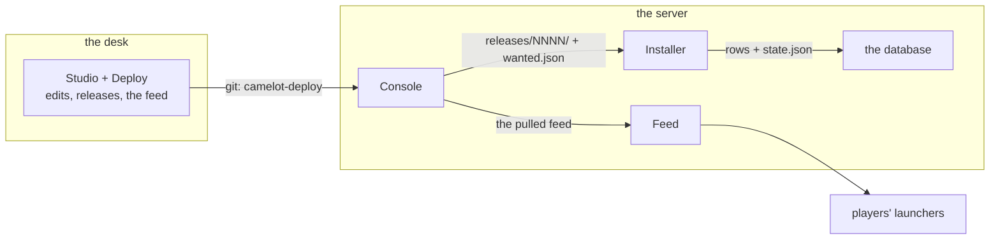

# Installing Camelot Forge

Installs the desk and the server. `docs/admin.md` is the runbook once this is
done, and `deploy/README.md` maps the containers.

| Surface | Runs on | What it does |
|---|---|---|
| Studio | the desk | the world editor and the asset library (`camelot studio …`) |
| Deploy | the desk | cuts releases, hands them to an environment, publishes the branch |
| Feed | built on the desk, served on the server | what the players' launcher reads |
| Console | the server | what is applied, what is wanted, Pull, Restart, Reverse |
| Installer | the server | the only writer of the server's own rows |



Releases reach the server as a git branch, `camelot-deploy`. Players' launchers
fetch content over HTTP from the feed.

## 1. What you need

### The desk

- Linux or macOS.
- Python 3.11 or later.
- `git`, and OpenSSH 8.0 or later. `ssh -V` prints the version; 8.0 is where
  `ssh-keygen -Y` appears, which signs releases.
- A DAoC client, the full install.
- OpenDAoC's database checkout, if you want a local test server. It is the
  baseline `env provision` imports.

### The server

- A machine you can ssh into, with Docker or Podman and the compose plugin.
- `git`, and a read-only deploy key on the project's repository.
- A clone of the studio repository: the `camelot-core` job is built from `core/`,
  so the server needs the source.
- The players' ports, **10300/tcp** and **10400/tcp+udp**, open in the host's
  firewall and forwarded by the NAT in front of it. The feed behind TLS. The
  Console and the database stay on loopback.

## 2. The desk

### 2.1 The studio

```sh
git clone git@github.com:camelot-forge/camelot-studio.git
cd camelot-studio
./bootstrap.sh                      # creates .venv, patches pyffi, installs core/ editable
.venv/bin/camelot --help
```

`bootstrap.sh` needs the network once. Every command below is
`.venv/bin/camelot` from here; add `.venv/bin` to your `PATH` if you would
rather type `camelot`.

Point the tools at your client:

```sh
export DAOC_CLIENT="$HOME/daoc/clean-client"    # add to ~/.bashrc or ~/.zshrc
```

The first run does not need it. `camelot serve` with no argument opens **Home**
with no client at all, and the **New project** modal asks for the folder; the
daemon adopts that client when the project opens. The variable is for the CLI
verbs that work on a client outside a project (`info`, `gltf`, `client install`,
`batch`, `contract`, the corpus tests). The project records its client in
`machine.json`, which is what `studio` reads.

### 2.2 The client, and the one rule

`project feed` and `project publish` stage a hardlinked copy of the client you
name, apply **every** release's client half to it, and copy into `feed/` the
files that no longer match it. Given the pristine base, the feed is a complete
snapshot: a player on that base downloads exactly what changed. Given a client
you have been playing from, the feed holds only the newest release's files and
stays correct by accident.

Keep two copies:

```sh
cp -a "/path/to/DAOC CLIENT" ~/daoc/clean-client     # never edit this one
cp -a ~/daoc/clean-client ~/daoc/play-client         # play from this one
```

The game client is about 5 GB and is not redistributable, so sync it between your
machines however you sync large files.

### 2.3 The project

One folder holds the whole content of one shard.

```sh
.venv/bin/camelot project new camelot-hills \
  --dir ~/daoc \
  --client "$DAOC_CLIENT" \
  --environments local,production \
  --git
```

That writes `project.json` (the shard's identity, and the fingerprint of the base
client), the folder shape, `.gitignore`, `.gitattributes`, and a `machine.json`
naming the client you passed.

`machine.json` carries this machine's paths and stays out of git. It is the only
file the project does not track; write it with `camelot project machine` (below),
or by hand, and read it back with `camelot project check`. Fill in one entry per
environment.

```json
{
  "author": "you",
  "client": "/home/you/daoc/clean-client",
  "environments": {
    "local": {
      "root": "/home/you/daoc/forge-env-local",
      "database": "forge_project_local",
      "baseline": "/home/you/daoc/OpenDAoC-Database/opendaoc-db-core",
      "db": { "host": "127.0.0.1", "port": 3307, "user": "root" },
      "db_config": "/home/you/daoc/forge-env-local/server/config/serverconfig.xml"
    },
    "production": {
      "root": "/srv/forge/env",
      "client": false
    }
  }
}
```

`"client": false` marks an environment **server-only**: the dry run then writes
only the server half.

Write the file with the tool:

```sh
.venv/bin/camelot project machine --dir ~/daoc/camelot-hills \
  --client "$DAOC_CLIENT" \
  --db-config ~/daoc/forge-env-local/server/config/serverconfig.xml \
  --release-key ~/daoc/keys/camelot-release
.venv/bin/camelot project check --dir ~/daoc/camelot-hills
```

`project machine` derives the environment's folder, database, host and port from
the `serverconfig.xml`. `project check` reads the file back and probes the
database; it refuses a config that opens another database than the one the file
names. `studio`, `release`, `publish` and `env` refuse to run
when the file is missing.

`populate` records the resources your edits lean on: each zone's placements and
its catalogue, and each client table whole. The three tables below are the ones
the editor reads rows out of, and they are the ones every client ships:

```sh
.venv/bin/camelot project populate --all-zones \
  --tables items.csv,monsters.csv,objects.csv \
  --dir ~/daoc/camelot-hills
.venv/bin/camelot project verify --dir ~/daoc/camelot-hills
```

`verify` reads the base back against the fingerprints `project.json` recorded and
says which file moved.

### 2.4 A local test server

Build the environment's own database from OpenDAoC's baseline, and patch a server
that runs on it.

```sh
.venv/bin/camelot env provision local --yes --dir ~/daoc/camelot-hills
.venv/bin/camelot env status local --dir ~/daoc/camelot-hills
```

`provision` drops the environment's database and imports the baseline into it,
then starts the Installer's record over. It refuses to drop a database this
project did not create, so it is safe on a machine that holds others, and it
refuses without `--yes`.

Three things it needs from you:

- **a MySQL or MariaDB** reachable at the `db` block's host and port. MariaDB
  10.6 is what OpenDAoC targets; `deploy/server/compose.yaml` runs one if you
  would rather not install it.
- **OpenDAoC's database checkout** at `baseline`. That is the `opendaoc-db-core`
  directory of the OpenDAoC-Database repository: the SQL the emulator's own
  schema comes from.
- **an OpenDAoC build** in `<root>/server`, with its `config/serverconfig.xml`
  pointing at the database `provision` created. That folder *is* the
  environment's server half, so the server's files belong there.

Put the server under a supervisor. The Console's **Restart** sends a shutdown, so
without something to start it again that action is a stop.

```ini
# ~/.config/systemd/user/camelot-server.service
[Unit]
Description=The shard
After=network-online.target

[Service]
WorkingDirectory=/home/you/daoc/forge-env-local/server
ExecStart=/home/you/daoc/forge-env-local/server/CoreServer
Restart=always
RestartSec=3

[Install]
WantedBy=default.target
```

```sh
systemctl --user enable --now camelot-server
```

Then read the environment back:

```sh
.venv/bin/camelot env verify local --dir ~/daoc/camelot-hills
```

`verify` compares the database's tables against the baseline's, the releases the
state records against the rows it holds, and the files in the folder.

### 2.5 Authoring

On a new machine, the first run has no client to name:

```sh
.venv/bin/camelot serve
```

It opens **Home**. **New project** asks for the folder, checks it, writes the
client into `machine.json` and adopts it; the same modal takes the environment's
`serverconfig.xml`, so the project also knows its database and its mobs. Once a
project exists, the daily verb is:

```sh
.venv/bin/camelot studio ~/daoc/camelot-hills          # read-only
.venv/bin/camelot studio ~/daoc/camelot-hills --edit   # the server's rows
```

`studio` reads `machine.json`, checks it (the same walk as `project check`),
starts the daemon and opens the browser. The client and the environment's
`serverconfig.xml` come from the file: there is nothing to export. `--edit` is
the explicit permission to patch the server's **existing** world rows; without
it the daemon serves read-only.

The environment's database must be running for the viewer to show mobs, statics
and doors. `project check` says whether it answers. The game server is not
needed to author — only to play and to `env deploy`.

A caller that passes everything explicitly — CI, a container, a machine with no
`machine.json` — still uses the daemon:

```sh
.venv/bin/camelot serve --project ~/daoc/camelot-hills --root "$DAOC_CLIENT" \
  --db-config ~/daoc/forge-env-local/server/config/serverconfig.xml --db-write
```

`--server-rows <snapshot>` replaces the live database with an export
(`camelot server export`), for a machine that must not reach MySQL.

The daemon takes a lock on the project; a second daemon serves read-only and names
the holder.

## 3. Two keys

**The deploy key** is what the server uses to **read** the repository. You
generate it on the server, and you add its `.pub` to the repository as a
read-only deploy key. Read-only scope matters: a server that can write the branch
can rewrite the release it pulls.

**The release key** is what the desk uses to **sign** a release. You generate it
on the desk, and the server gets only the `.pub`.

```sh
# on the desk
ssh-keygen -t ed25519 -C camelot-release -f ~/daoc/keys/camelot-release
```

Then name it in `machine.json`:

```json
{ "release_key": "/home/you/daoc/keys/camelot-release" }
```

A key with a passphrase works. Signing from a terminal prompts for it, and
`ssh-add ~/daoc/keys/camelot-release` once per session removes the prompt. A
publish from a job has no terminal, so it needs the agent or a key without a
passphrase.

The hashes in `release.json` travel in the same commit as the files they
describe, so whoever can write the branch can rewrite both. A signature over the
record covers those hashes too, which is what lets a server check a release
without trusting the branch it pulled from.

## 4. The server

`deploy/install/` is the server install: one compose file, named volumes, and a
bootstrap job. It needs no prepared directory tree.

```sh
git clone git@github.com:camelot-forge/camelot-studio.git
cd camelot-studio/deploy/install
./install.sh          # writes .env, generates the passwords, and exits
$EDITOR .env          # the five FILL values
./install.sh
```

`deploy/install/README.md` walks the deploy key, the release key, Coolify, the
ports and the first release; `docs/coolify.md` is the Coolify-specific
production walk. The rest of this section is the same stack by hand, for a
machine whose directories you manage yourself.

### 4.1 The checkout

A clone of the project on the branch the desk publishes.

```sh
ssh-keygen -t ed25519 -f /srv/forge/keys/deploy -N ''
# add /srv/forge/keys/deploy.pub to the repository as a read-only deploy key
GIT_SSH_COMMAND='ssh -i /srv/forge/keys/deploy' \
  git clone --branch camelot-deploy --single-branch \
  git@github.com:you/camelot-hills.git /srv/forge/deploy
```

The branch only exists once the desk has published something, so publish once
before you get here (§5). Give the checkout a `machine.json` of its own, from
`deploy/server/machine.json.example`; it is in the project's `.gitignore`, so a
pull never touches it.

### 4.2 The stack, and the environment folder

`<env>/server/camelot/` is the part of the environment that is ours: the
Installer writes there, the Console asks there, and it is the part to back up.

The `camelot-core` job is built from `core/`, so the server gets the source:

```sh
git clone git@github.com:camelot-forge/camelot-studio.git /srv/forge/studio
cd /srv/forge/studio/deploy
cp .env.example .env
$EDITOR .env
```

The values that differ between a desk and a VPS are the feed's public URL, the
game's public address, and the secrets. `deploy/.env.example` names every one.

### 4.3 The first run

The job needs the database, and the game server needs the tables, so the order
matters. From `deploy/`, where `compose.yaml` lives:

```sh
docker compose up -d db
server/camelot.sh provision     # the baseline, then every release the checkout carries
docker compose up -d            # db, core, feed, console
server/camelot.sh api '<a password>'
server/camelot.sh restart       # the API host starts at boot only
curl -s http://127.0.0.1:8080/healthz
```

With the current OpenDAoC image (dotnet 10), the API defaults to `8080`
(`ASPNETCORE_HTTP_PORTS`). Add `ASPNETCORE_URLS=http://127.0.0.1:5000` to the
`core` service before `docker compose up -d`; the Console reads `:5000`.

`camelot.sh` is a wrapper over `docker compose run --rm camelot-core`, and the
verbs are `provision`, `apply`, `reverse`, `status`, `verify`, `api`, `restart`
and `logs`.

The API host is the one thing that needs the restart: `/serverproperties refresh`
in game does not bring it up, so a fresh server has no read API until it boots
again.

### 4.4 The Console

The Console checks signatures with the operator's public key. Copy it to the
server; it is public, so copying is the whole distribution.

```sh
scp ~/daoc/keys/camelot-release.pub forge:/srv/forge/keys/
```

Two values in `.env`: the host directory that holds the keys, and the path the
key has inside the container.

```sh
CAMELOT_KEYS_DIR=/srv/forge/keys
CAMELOT_RELEASE_KEY=/keys/camelot-release.pub
```

The Console is on `http://127.0.0.1:8770/`, authenticated as `operator` with
`CAMELOT_CONSOLE_PASSWORD`. Beyond loopback a password is required. It reads the
Installer's state, the feed's version, the game port and the API, and it writes
three things: the handover, the audit, and the asks.

With `CAMELOT_RELEASE_KEY` set, **Pull** checks the signature before it believes
the hashes and refuses a release nobody signed. With it empty, the page says the
server does not check, every time it loads.

### 4.5 After a reboot

`core` runs with `restart: unless-stopped`, so the container is its own
supervisor and the Console's **Restart** works. What has to come back at boot is
the stack itself:

```sh
sudo systemctl enable docker     # or podman, whichever runs the stack
```

`docker compose up -d` once is then enough for every reboot after it.
`deploy/README.md` says which ports to expose and which to leave on loopback.

### 4.6 The Installer at boot

Two ways to run the Installer, and the Console cannot tell them apart: the
`camelot-core` job above, and the C# plugin, which applies at boot.

**The server install (`deploy/install/`) includes the plugin.** `core` is built
from `deploy/core/Dockerfile`: OpenDAoC's pinned digest plus the three `.cs`,
with `SCRIPT_ASSEMBLIES=Newtonsoft.Json` and the `forge-camelot` volume at
`/app/camelot`. The admin flow is Pull → Restart.

On a server without that image, copy the plugin once:

```sh
mkdir -p /srv/forge/env/server/scripts/camelot-installer
cp /srv/forge/studio/server-bridge/camelot-installer/*.cs \
   /srv/forge/env/server/scripts/camelot-installer/
# add Newtonsoft.Json to <ScriptAssemblies> in config/serverconfig.xml
docker compose restart core
```

It is a manual step once, because the server compiles its scripts *before* any
hook runs: a release cannot carry it. `server-bridge/camelot-installer/README.md`
has the details.

## 5. The first release, end to end

The sequence that carries one edit to the players, in the order it runs.

```sh
# on the desk — or, in the browser: Deploy → Cut → Deploy → Ship
.venv/bin/camelot project release --dir ~/daoc/camelot-hills     # cuts release 0001
.venv/bin/camelot project deploy 1 --env local --dir ~/daoc/camelot-hills
.venv/bin/camelot env apply local --dir ~/daoc/camelot-hills     # or the Installer, at boot
.venv/bin/camelot env reload local --dir ~/daoc/camelot-hills    # records the ritual, in game

# feed, signature and the deploy branch in one verb (the page's Ship)
.venv/bin/camelot project publish 1 --remote origin --dir ~/daoc/camelot-hills

# on the server
#   Console → Pull        fetch, check the signature, verify the hashes, hand over, mark wanted
#   Console → Restart     boot the server; the plugin applies the release before the world loads

# the players
#   their launchers read the feed and update themselves
```

A release is immutable once cut, and `camelot project verify --rebuild N` proves
it. A second clone rebuilds the same bytes from the journal. A deploy copies a
release into an environment, a publish commits it to the branch; the Installer is
what writes rows.

The desk's dry run is the step to read before you publish. Without `--dry-run` it
is the deploy itself:

```sh
.venv/bin/camelot project deploy 1 --env production --dry-run --dir ~/daoc/camelot-hills
```

It names every destination, what is ours, what is already there, and it refuses
on drift or on an id the environment already holds.

## 6. The players

The package is built once per platform and per shard:

```sh
cd web/launcher && pnpm install && pnpm build && cd ../..
.venv/bin/python packaging/launcher/build.py \
  --name "Camelot Hills" --feed "https://patch.example/"
```

That leaves `packaging/dist/camelot-launcher/` and a zip beside it. `shard.json`
carries the shard's name and the feed's URL: the game's address comes from the
feed's `launcher.json`, which the feed service writes on every request.

Hand out the launcher and the client. Every player has to start from the **same
base client** the desk fingerprinted into `project.json`, because the feed is a
delta against it; a client from somewhere else gets the right files and the wrong
result. The launcher refuses Play while the client is behind the feed, and it
stores the client folder and the account in
`~/.config/camelot-launcher/settings.json`. The password is never written there.

On Windows `connect.exe` runs directly. On Linux the launcher runs it under Wine
and the launcher's settings name the prefix.

## 7. What to back up

| What | Where | Why |
|---|---|---|
| the project | the desk, and the git remote | the journal is the source of every release |
| the environment's `server/camelot/` | the server | the state, the applied evidence, and the values each release replaced |
| the release key | the desk | lose it and you generate a new one, publish again, and swap the `.pub` on the server |
| the deploy key | the server | a read-only clone is reproducible; the key is a minute's work |
| the feed directory | the server | rebuilt from the project in one command |

The database is reproducible: the baseline plus the releases rebuild it, so a dump
is a convenience. The one thing no command can rebuild is the environment's
`camelot/` folder, because it holds the values each release replaced, and that is
what a reversal is written against.
